# Trabalho final – Mininet

## Questão 1 – Topologia em árvore (profundidade 3, ramificação 5)

### a) Criação da topologia

```
sudo mn --topo=tree,depth=3,fanout=5 --mac --link tc,bw=30
```

Topologia em árvore com 31 switches e 125 hosts, MAC padronizado, enlaces de 30 Mbps e controlador padrão do Mininet.

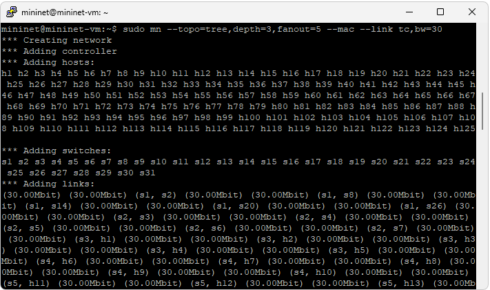

### b) Interfaces, endereços MAC, IP e portas

```
nodes
```

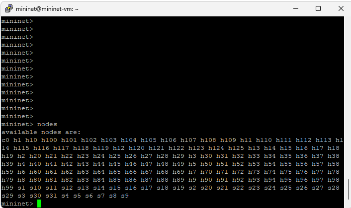

```
net
```

Cada host usa a interface `eth0`. Nos switches de borda, as portas `eth1` a `eth5` ligam os hosts.

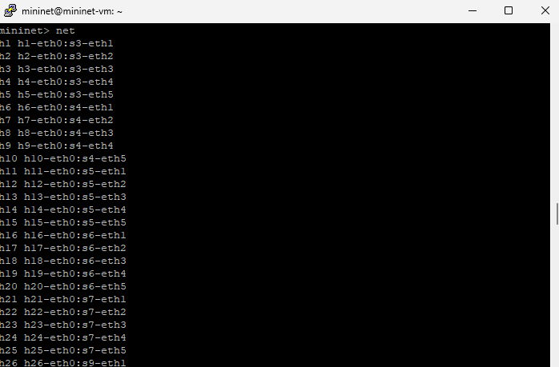

```
dump
```

IPs dos hosts na rede 10.0.0.0/8 (h1 = 10.0.0.1 … h125 = 10.0.0.125) e controlador c0 em 127.0.0.1:6653.

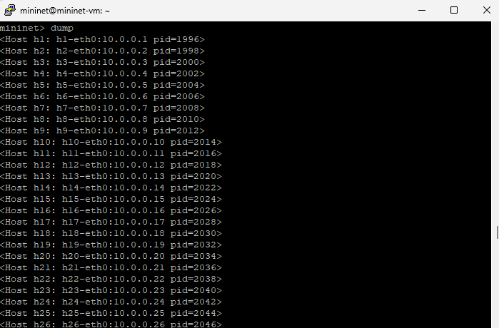

```
h1 ifconfig -a
h125 ifconfig -a
```

MAC padronizado: h1 = `00:00:00:00:00:01` e h125 = `00:00:00:00:00:7d`.

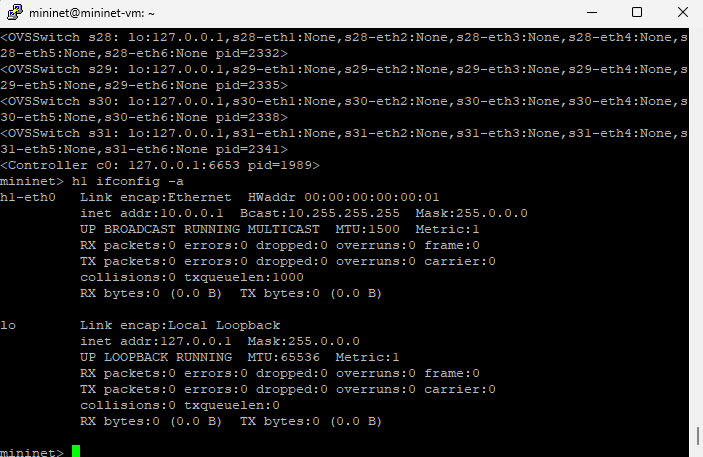
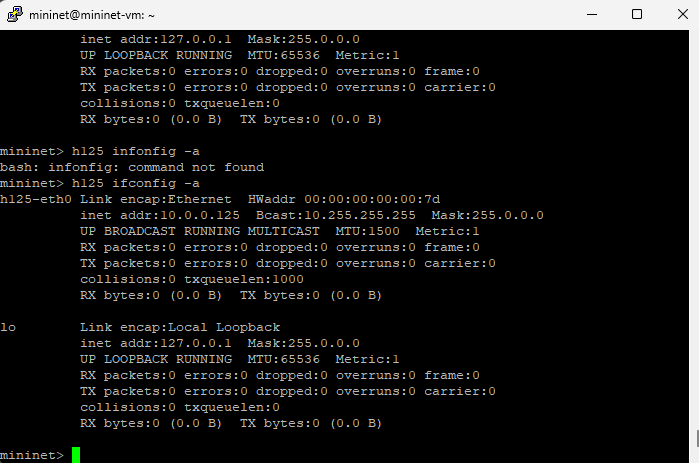

```
s1 ifconfig -a
s3 ifconfig -a
```

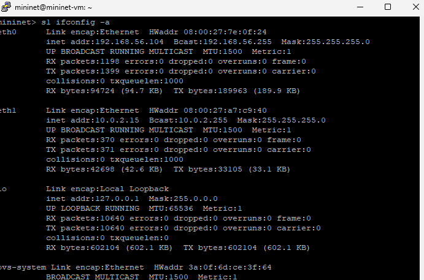
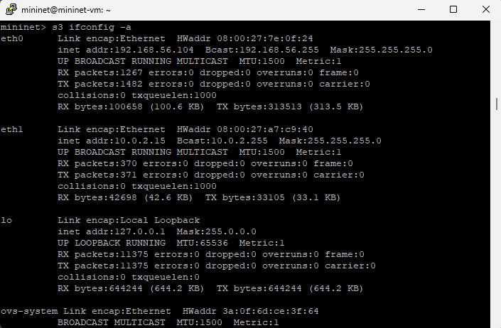

```
xterm h1
sudo ovs-ofctl show s1
sudo ovs-ofctl show s3
```

Portas OpenFlow de cada switch com o respectivo endereço MAC.

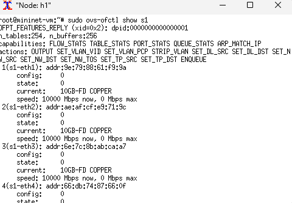
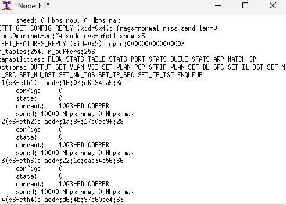

### c) Desenho da topologia

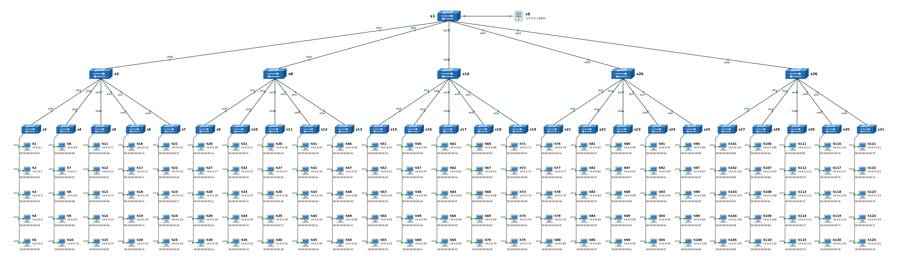

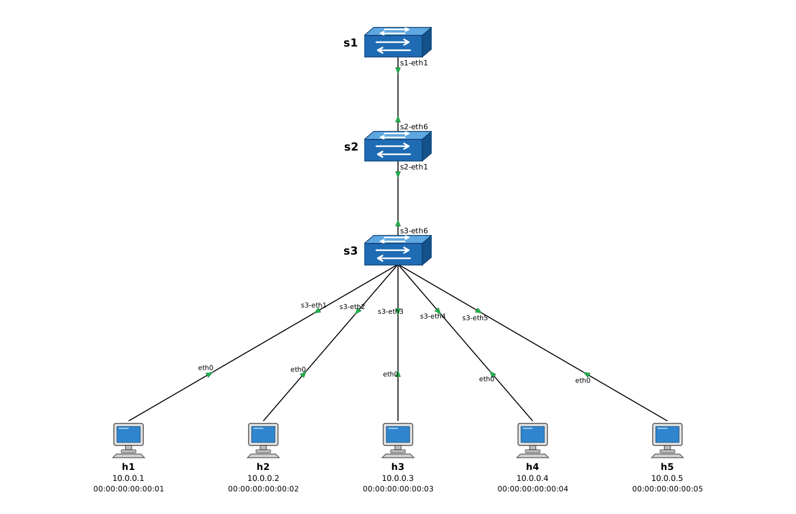

### d) Testes de ping e tcpdump

```
pingall
```

Resultado: **0% dropped (15500/15500 received)**.

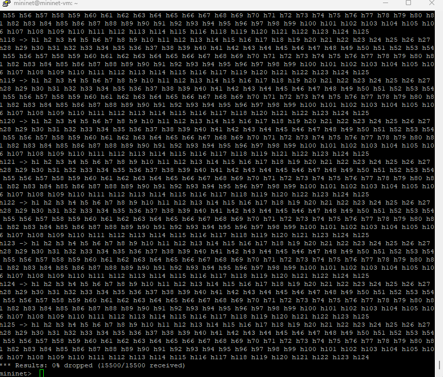

```
h1 ping -c 5 h125
```

Ping entre hosts de ramos diferentes da árvore, passando pelo switch raiz s1.

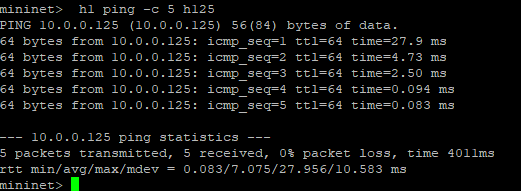

```
xterm h1 h2 h3
tcpdump -XX -n -i h2-eth0      (no h2)
tcpdump -XX -n -i h3-eth0      (no h3)
ping -c1 10.0.0.2              (no h1)
```

O h2 recebe o ARP e o ICMP (echo request/reply). O h3 recebe apenas o ARP em broadcast.

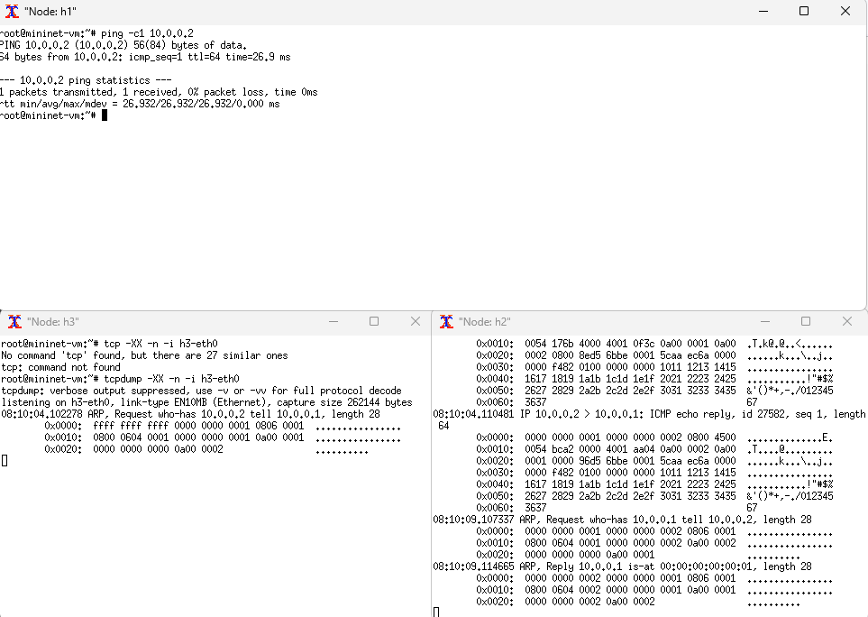

### e) iperf – h1 servidor TCP na porta 5555, h2 cliente, 20 segundos

```
xterm h1 h2
iperf -s -p 5555 -i 1                      (no h1)
iperf -c 10.0.0.1 -p 5555 -i 1 -t 20       (no h2)
```

**bw = 30 Mbps:** vazão de aproximadamente 27 Mbits/sec por intervalo.

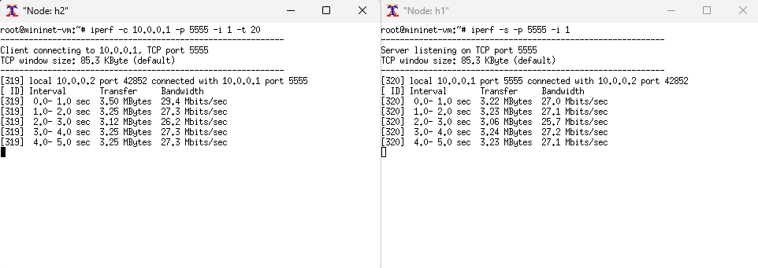

**bw = 40 Mbps** (topologia reconstruída):

```
sudo mn -c
sudo mn --topo=tree,depth=3,fanout=5 --mac --link tc,bw=40
```

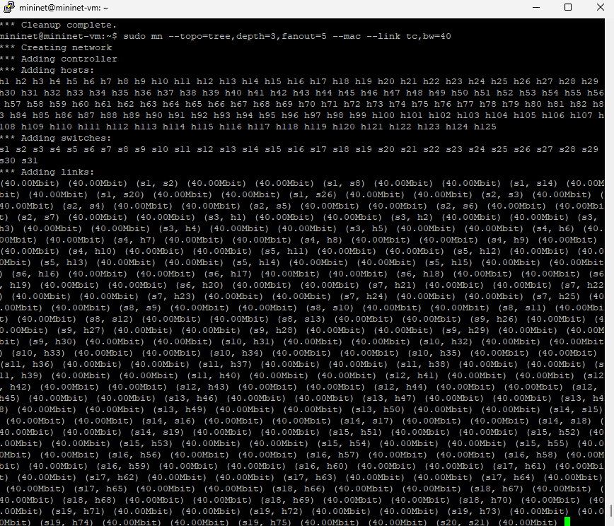

Resultado: 84,9 MBytes em 20 s, com **35,2 Mbits/sec** (servidor) e **35,5 Mbits/sec** (cliente).

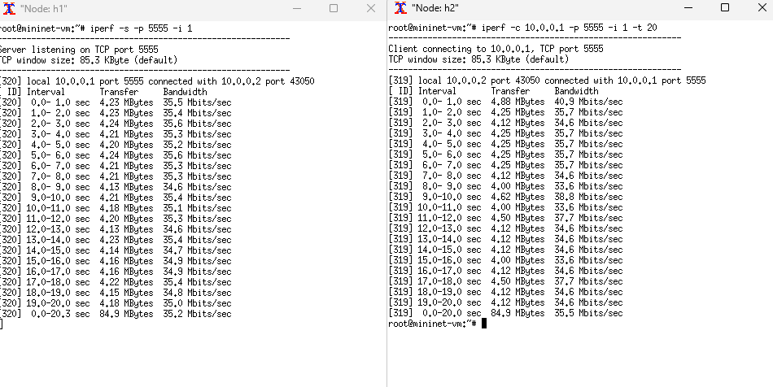

| bw configurado | Vazão medida |
|---|---|
| 30 Mbps | ~27 Mbits/sec |
| 40 Mbps | ~35,5 Mbits/sec |

A vazão acompanha a banda configurada e fica um pouco abaixo dela por causa dos cabeçalhos TCP/IP/Ethernet.

---

## Questão 2 – Topologia customizada em Python

### a) Código e criação da topologia

[`topo.py`](topo.py)

```python
from mininet.topo import Topo

class MyTopo( Topo ):
    "Topologia customizada com 3 switches e 5 hosts."

    def __init__( self ):
        "Criar topologia customizada."

        # Inicializar topologia
        Topo.__init__( self )

        # Criar os hosts
        host1 = self.addHost( 'h1' )
        host2 = self.addHost( 'h2' )
        host3 = self.addHost( 'h3' )
        host4 = self.addHost( 'h4' )
        host5 = self.addHost( 'h5' )

        # Criar os switches
        Switch1 = self.addSwitch( 's1' )
        Switch2 = self.addSwitch( 's2' )
        Switch3 = self.addSwitch( 's3' )

        # Criar os links dos hosts
        self.addLink( host1, Switch1 )
        self.addLink( host2, Switch1 )
        self.addLink( host3, Switch2 )
        self.addLink( host4, Switch3 )
        self.addLink( host5, Switch3 )

        # Criar os links entre os switches
        self.addLink( Switch1, Switch2 )
        self.addLink( Switch2, Switch3 )


topos = { 'mytopo': ( lambda: MyTopo() ) }
```

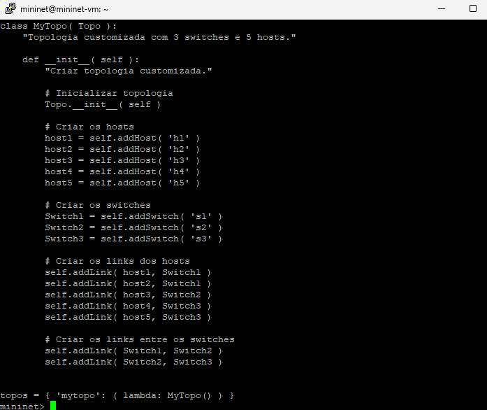

```
sudo mn --custom topo.py --topo mytopo --controller=none --mac
```

Topologia customizada com MAC padronizado e controlador manual.

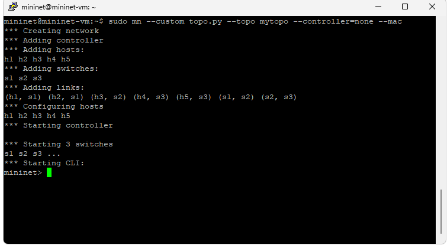

### b) Interfaces, endereços MAC, IP e portas

```
nodes
net
dump
```

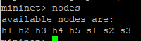
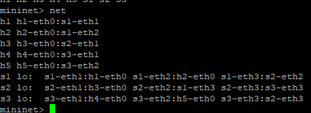
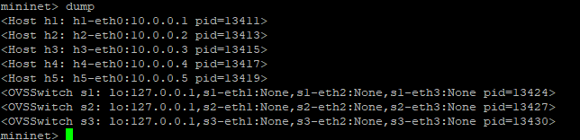

| Switch | eth1 | eth2 | eth3 |
|---|---|---|---|
| s1 | h1 | h2 | s2 (s2-eth2) |
| s2 | h3 | s1 (s1-eth3) | s3 (s3-eth3) |
| s3 | h4 | h5 | s2 (s2-eth3) |

```
h1 ifconfig -a
h2 ifconfig -a
h3 ifconfig -a
h4 ifconfig -a
h5 ifconfig -a
```

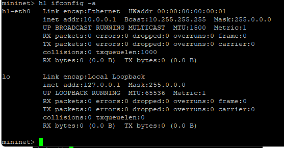
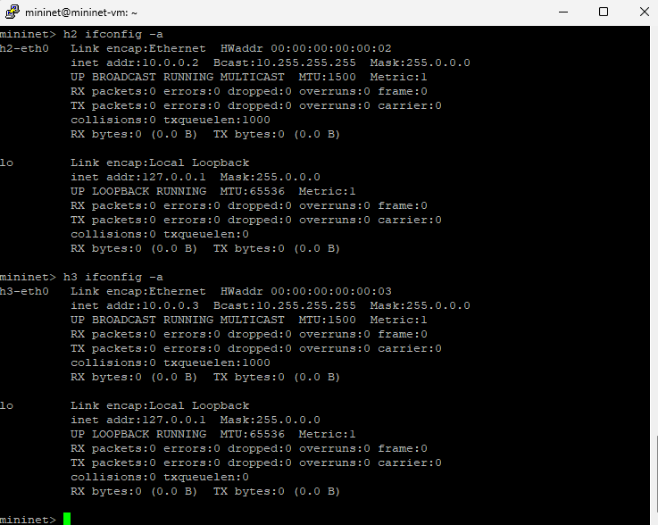
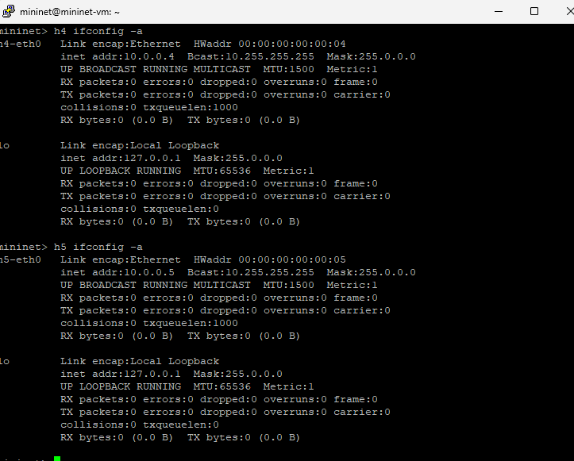

```
s1 ifconfig -a
```

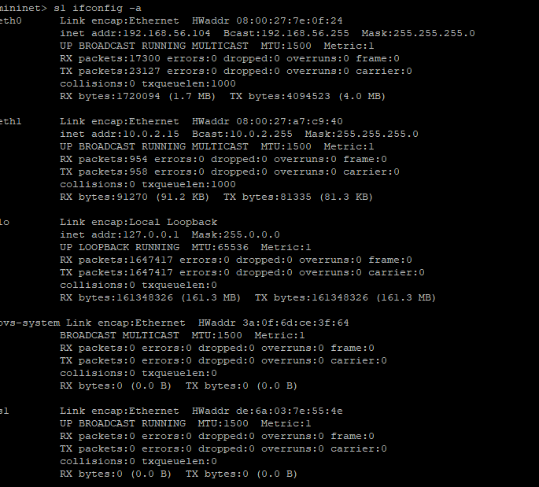

```
xterm h1
sudo ovs-ofctl show s1
sudo ovs-ofctl show s2
sudo ovs-ofctl show s3
```

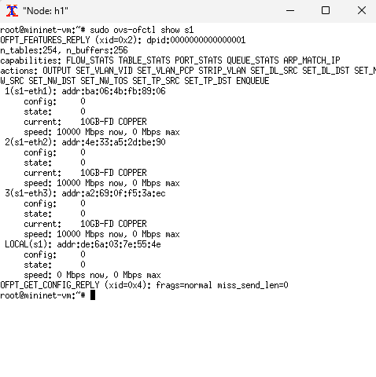
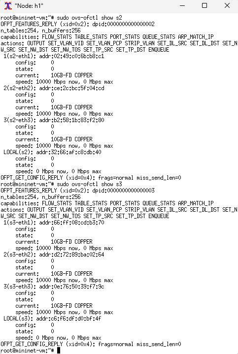

### c) Desenho da topologia

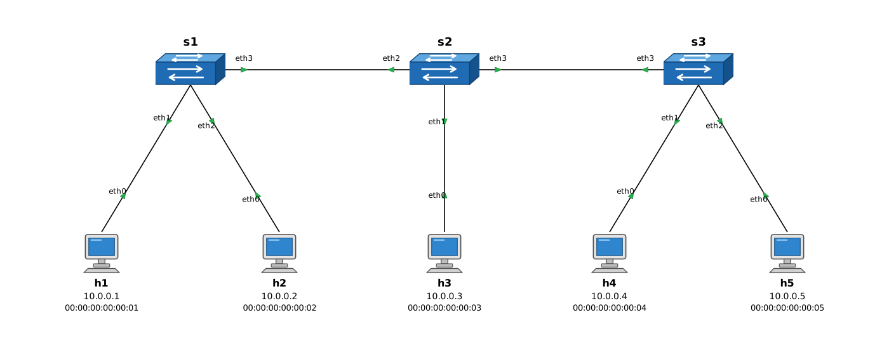

### d) Ping com os switches normais

Sem controlador e sem regras, não há comunicação:

```
pingall
```

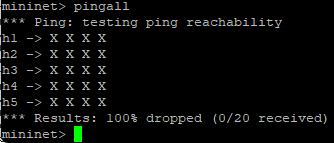

```
sudo ovs-ofctl add-flow s1 action=normal
sudo ovs-ofctl add-flow s2 action=normal
sudo ovs-ofctl add-flow s3 action=normal
sudo ovs-ofctl dump-flows s1
```

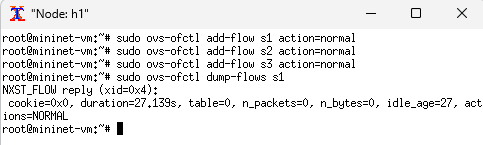

Com os switches em modo normal: **0% dropped (20/20 received)**.

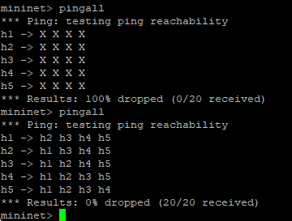

### e) Regras baseadas em endereços MAC

Apagando as regras anteriores:

```
sudo ovs-ofctl del-flows s1
sudo ovs-ofctl del-flows s2
sudo ovs-ofctl del-flows s3
sudo ovs-ofctl dump-flows s1
```

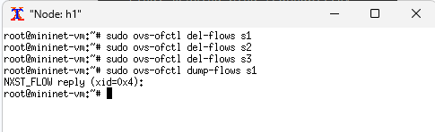
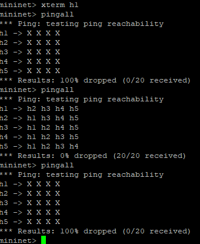

Regras por MAC para **h1 ↔ h4** (s1 – s2 – s3) e **h2 ↔ h3** (s1 – s2), com ARP em flood:

```
sudo ovs-ofctl add-flow s1 dl_src=00:00:00:00:00:01,dl_dst=00:00:00:00:00:04,actions=output:3
sudo ovs-ofctl add-flow s1 dl_src=00:00:00:00:00:04,dl_dst=00:00:00:00:00:01,actions=output:1
sudo ovs-ofctl add-flow s1 dl_src=00:00:00:00:00:02,dl_dst=00:00:00:00:00:03,actions=output:3
sudo ovs-ofctl add-flow s1 dl_src=00:00:00:00:00:03,dl_dst=00:00:00:00:00:02,actions=output:2

sudo ovs-ofctl add-flow s2 dl_src=00:00:00:00:00:01,dl_dst=00:00:00:00:00:04,actions=output:3
sudo ovs-ofctl add-flow s2 dl_src=00:00:00:00:00:04,dl_dst=00:00:00:00:00:01,actions=output:2
sudo ovs-ofctl add-flow s2 dl_src=00:00:00:00:00:02,dl_dst=00:00:00:00:00:03,actions=output:1
sudo ovs-ofctl add-flow s2 dl_src=00:00:00:00:00:03,dl_dst=00:00:00:00:00:02,actions=output:2

sudo ovs-ofctl add-flow s3 dl_src=00:00:00:00:00:01,dl_dst=00:00:00:00:00:04,actions=output:1
sudo ovs-ofctl add-flow s3 dl_src=00:00:00:00:00:04,dl_dst=00:00:00:00:00:01,actions=output:3

sudo ovs-ofctl add-flow s1 dl_type=0x806,nw_proto=1,action=flood
sudo ovs-ofctl add-flow s2 dl_type=0x806,nw_proto=1,action=flood
sudo ovs-ofctl add-flow s3 dl_type=0x806,nw_proto=1,action=flood
```

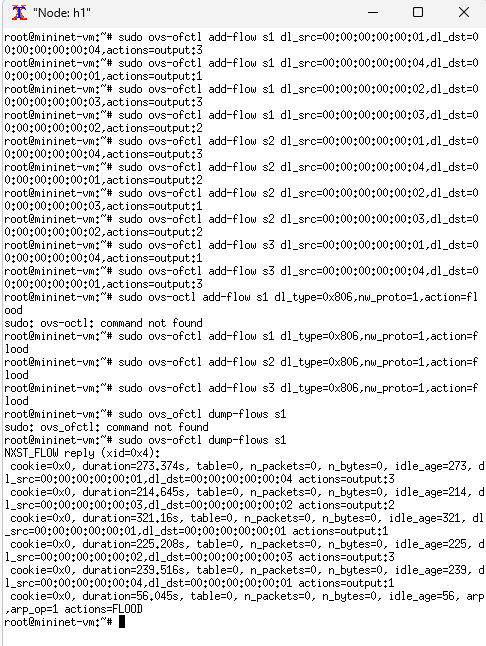
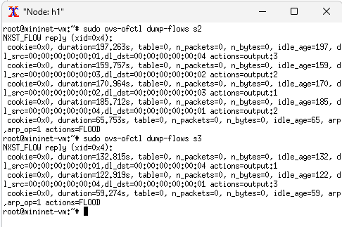

### f) Testes de ping com as regras

```
h1 ping -c 5 h4
h2 ping -c 5 h3
h1 ping -c 5 h5
```

h1 → h4 e h2 → h3 funcionam (0% de perda). h1 → h5 falha, pois não há regra para esse par.

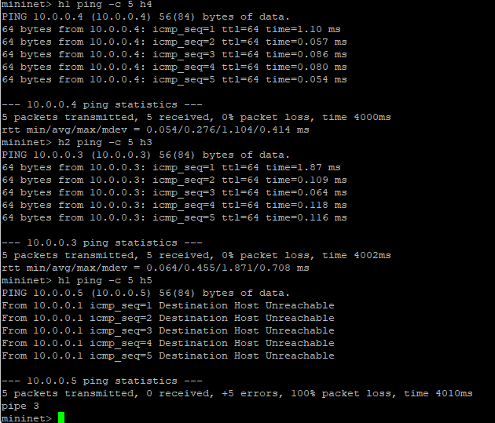

```
pingall
```

Apenas os pares com regra se comunicam: **80% dropped (4/20 received)** – h1 ↔ h4 e h2 ↔ h3.

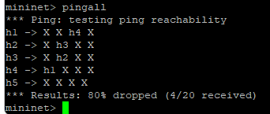

```
sudo ovs-ofctl dump-flows s2
```

Os contadores `n_packets` das regras usadas aumentaram, confirmando que o tráfego passou pelas regras criadas.

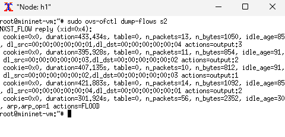
